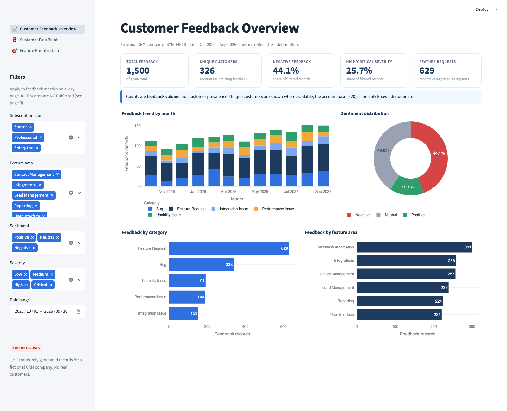
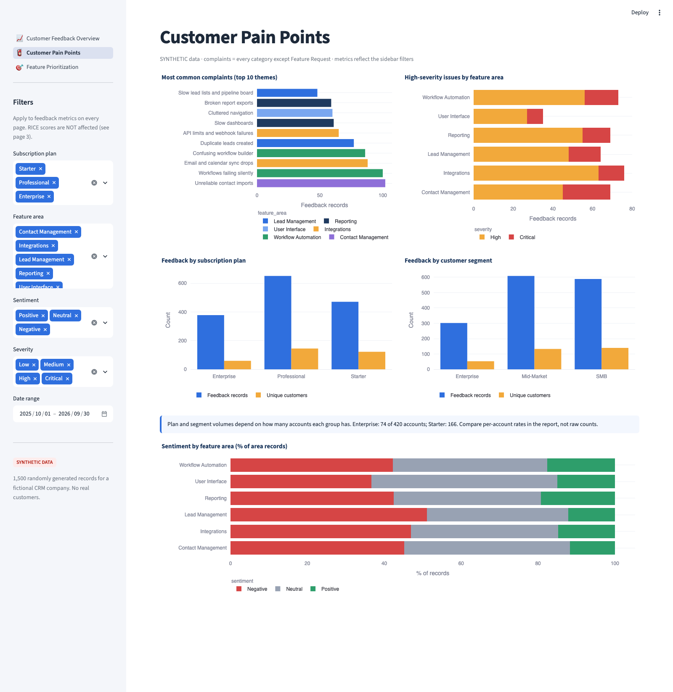
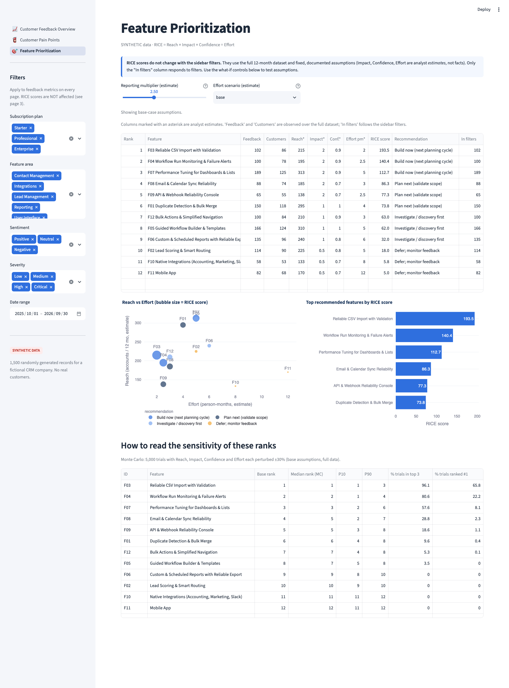

# CRM Customer Feedback Analysis & Feature Prioritization

> **All data in this project is SYNTHETIC.** 1,500 feedback records and 420 customer accounts were randomly generated (fixed seed) for a *fictional* B2B SaaS CRM company. No real customers or companies are represented, and no product outcomes are claimed.

An end-to-end Product Analyst workflow: **feedback → cleaning → exploration → pain points → RICE prioritization → PRD → recommendations**, delivered as Python scripts, an Excel workbook, a Streamlit dashboard and written reports.

## 1. Project Overview
A product team wants to know what customers complain about, which features hurt most, which segments report most, what is requested, and what to build first. This repo answers those questions from synthetic support tickets, surveys, feature requests and in-app feedback.

## 2. Business Problem
1. Most common complaints? 2. Which features cause most problems? 3. Which segments report most issues? 4. Most requested features? 5. Sentiment by subscription? 6. What to prioritize? 7. How should the top feature be specified in a PRD?

## 3. Objectives
Reproducible pipeline · validated data · honest metrics (volume ≠ prevalence) · transparent RICE with sensitivity analysis · PRD for the top-ranked feature · recruiter-friendly dashboard.

## 4. Technology Stack
Python 3 · Pandas · NumPy · OpenPyXL · Streamlit · Plotly · pytest · Playwright (screenshots/E2E) · RICE framework. (No Power BI needed; works on macOS Apple Silicon.)

## 5. Dataset Description (SYNTHETIC)
`data/raw/feedback_raw.csv` (1,500 rows × 12 columns) and `data/raw/customers.csv` (420 accounts with plan, segment, seats, industry, signup date). Period: 2025-10-01 → 2026-09-30. Required columns: `feedback_id, customer_id, submission_date, feedback_source, subscription_plan, customer_segment, feature_area, feedback_category, feedback_text, sentiment, severity, customer_impact`.
Generator design (disclosed, not tuned to force results): 24 customer-problem themes with plan-specific weights, category-dependent sentiment/severity, a workflow-failure spike (10 Feb–3 Mar 2026) and a UI-lag spike (June 2026). The raw file contains deliberate formatting noise (whitespace/casing, 45 non-ISO dates, 12 blank `customer_impact`).

## 6. Data Cleaning
`clean_data.py` normalises categorical values, parses mixed date formats, imputes blank impact as `Unknown`, and tags each record with an issue theme via keyword rules. `validate_data.py` runs checks on raw and cleaned data (row count, duplicate IDs, customer-ID integrity, dates, valid categories) and writes `reports/data_quality_report.md`. Raw data fails the category check as expected (injected noise); cleaned data passes all checks.

## 7. Customer Feedback Analysis
`analyze_feedback.py` computes volume by area/category/plan/segment/source, sentiment and severity distributions, monthly trends, top complaints and requests, and high-severity issues by area. Every table reports **feedback records and unique customers** separately; per-account rates use the known 420-account base.

## 8. Key Findings (computed; see `reports/product_insights.md`)
- 1,500 records from **326 of 420 accounts**; 44.1% negative; 25.7% High/Critical; 629 feature requests (41.9%).
- Volume by area is fairly even (14.7%–20.1%); Workflow Automation is largest (301 records, 175 accounts).
- Top complaint themes: unreliable contact imports (102 records / 86 accounts), workflows failing silently (100 / 78), email & calendar sync drops (88 / 74).
- Top request: Mobile app (82 / 68), then workflow templates (80 / 69).
- Professional has the most records (651) mainly because it has the most accounts; per account, Enterprise submits most (5.11 vs 2.84 for Starter). Enterprise's lower negative share (38.9%) is a *mix effect* (more feature requests), not evidence of higher satisfaction.

## 9. RICE Prioritization
12 feature opportunities scored programmatically (`calculate_rice.py`, assumptions in `data/assumptions/feature_assumptions.csv`). Observed inputs: records, accounts, severity. **Estimates:** reporting multiplier (2.5), Impact tiers, Confidence rule, Effort. Top 5: **F03 CSV Import (193.5)**, F04 Workflow Monitoring (140.4), F07 Performance Tuning (112.7), F08 Email/Calendar Sync (86.3), F09 API/Webhook Console (77.3). Sensitivity: 8 alternative-assumption scenarios + 5,000-trial Monte Carlo (±30%). F03 stays #1 in every scenario and in 65.8% of Monte Carlo trials; mid-table ranks move by up to 3 places. RICE scores are decision aids, not facts. Details: `reports/feature_prioritization.md`.

## 10. PRD Overview
`reports/product_requirements_document.md` — 17-section PRD for **Reliable CSV Import with Validation** (pre-import validation, saved mappings, row-level error report). It is a *proposal*; nothing is implemented, and success-metric baselines must be measured first.

## 11. Dashboard Screenshots
Captured from the running app with Playwright.





Filters (plan, feature area, sentiment, severity, date range) update feedback metrics. **RICE scores do not change with filters** (full dataset, fixed assumptions); page 3 says so and offers what-if controls.

## 12. Product Recommendations (hypotheses)
Build F03, F04, F07 first after validating effort with engineering; run discovery for ranks 7–9; keep 10–12 on a watch list; re-estimate Impact for feature requests with interviews; track unique reporting accounts per theme.

## 13. Assumptions, Limitations and Known Issues
Full detail: [`reports/methodology_and_limitations.md`](reports/methodology_and_limitations.md).
- **Synthetic data:** every pattern is a product of the generator's design (theme weights by plan, two disclosed incident spikes). Findings demonstrate the *method*, not real customer behaviour.
- **Circular issue tagger:** `themes.py` supplies both the phrases the generator writes and the keywords the tagger matches, so the 100% coverage / zero ambiguity is **not** evidence of real-world text-classification accuracy.
- **151 records (10.1%) not in the RICE model:** themes `contact_custom`, `int_sso`, `rep_forecast`, `wf_approval` (custom fields/hierarchy, SSO/provisioning, sales forecasting, approval steps) were tagged but not mapped to any of the 12 opportunities. The other 1,349 records are covered.
- **RICE estimates:** Reporting multiplier (2.5), Impact tiers, Confidence rule and Effort are analyst estimates; Impact is severity-based, which under-values strategic feature requests. Scores are decision aids, not facts.
- Feedback volume is not customer prevalence; the 420-account customer master is the only denominator.
- No revenue, churn or support-cost data; single 12-month window.

## 14. Installation
```bash
python3 -m venv .venv && source .venv/bin/activate
pip install -r requirements.txt
playwright install chromium   # only for screenshots/E2E
```

## 15. How to Run
```bash
./run_pipeline.sh                                   # data → clean → validate → analyse → RICE → Excel → reports → tests
streamlit run dashboards/streamlit/app.py --server.port 8599
python scripts/capture_screenshots.py               # with the dashboard running; E2E checks + screenshots
```
Tests actually executed are recorded in `tests/TEST_RESULTS.md`.

## 16. Project Structure
```
data/{raw,processed,assumptions}   scripts/   dashboards/{streamlit,screenshots}
excel/CRM_Feedback_Analysis.xlsx   reports/   tests/   run_pipeline.sh   requirements.txt
```
Workbook: Executive Summary, Raw Feedback, Cleaned Feedback, Feedback Analysis (COUNTIF formulas), Feature Prioritization, RICE Calculations (editable estimates → live scores/ranks), Product Recommendations.
